[filename](common/common_ue_header.md ':include')

[filename](common/copy_plugin.md ':include')

# **RevenueCat Goodies**

Welcome to RevenueCat Goodies Documentation for Unreal Engine

---

The plugin integrates [RevenueCat](https://www.revenuecat.com/) - a backend for in-app purchases and subscriptions - into Unreal Engine. On Android it wraps the official [RevenueCat Android SDK](https://github.com/RevenueCat/purchases-android) (through [purchases-hybrid-common](https://github.com/RevenueCat/purchases-hybrid-common)), on iOS - the official [RevenueCat iOS SDK](https://github.com/RevenueCat/purchases-ios), and on desktop it uses the [RevenueCat REST API](https://www.revenuecat.com/docs/api-v1) together with [Web Billing](https://www.revenuecat.com/docs/web/web-billing/overview).

?> The plugin functionality wraps around native calls and should be used with the same recommendations and flows, as the original SDKs.

Unlike working with the stores directly, you get **one Blueprint and C++ API for all platforms**: the same nodes load products, make purchases and check what the player has access to on Android, iOS and PC. RevenueCat validates the receipts, keeps track of subscriptions (renewals, cancellations, refunds, grace periods) and shows your revenue in the dashboard.

Supported platforms:

- Android
- iOS
- Windows, Mac, Linux and the Editor (Play In Editor) - via RevenueCat Web Billing

# How it works

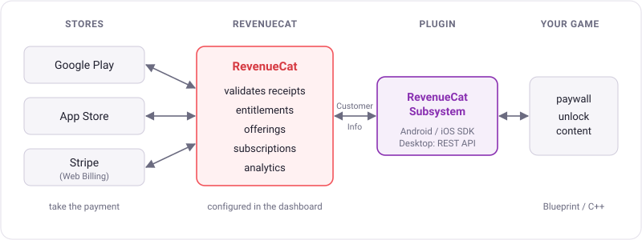

The store (Google Play, App Store or Stripe) only takes the payment. RevenueCat receives every transaction, validates it and decides what the player has access to. The plugin asks RevenueCat for this information and gives it to your game.

These are the main RevenueCat terms used in this documentation:

- **Project** - your game in the RevenueCat dashboard. One project contains all platforms of the game.
- **App** - one store inside the project: App Store, Google Play or Web Billing. Every app has its own public API key.
- **Product** - an item you sell, created in the store (e.g. `pro_monthly` in Google Play Console) and imported to RevenueCat.
- **Entitlement** - a level of access the player gets after a purchase, e.g. `pro` or `no_ads`. Several products from different stores can unlock the same entitlement. **Your game should check entitlements, not products.** See the [official documentation](https://www.revenuecat.com/docs/getting-started/entitlements).
- **Offering** - a set of products you show on your paywall, configured remotely in the dashboard. You can change prices or the set of products without updating the game. One offering is marked as **Current**. See the [official documentation](https://www.revenuecat.com/docs/offerings/overview).
- **Package** - one entry of an offering (e.g. `$rc_monthly`, `$rc_annual`, `$rc_lifetime`). A package contains the equivalent product for every store, so the same paywall works on all platforms.
- **App User ID** - the identifier of the player in RevenueCat. It is either anonymous (`$RCAnonymousID:...`, created automatically) or your own ID from your account system. See the [official documentation](https://www.revenuecat.com/docs/customers/user-ids).
- **Customer Info** - everything RevenueCat knows about the current player: active entitlements, active subscriptions and a subscription management URL.

A typical setup: one product per store (e.g. `pro_monthly` in Google Play, App Store and Web Billing) → all of them attached to the `pro` entitlement → one `default` offering with a `$rc_monthly` package that contains these products. The game shows the `default` offering, buys the package and then checks whether the `pro` entitlement is active.

# Setup

The plugin contains a demo level in the `Content/Demo` folder. It is recommended to try the demo before writing your own implementation. See the [Demo](ue-plugins/revenuecat-unreal?id=demo) section.

## RevenueCat dashboard

?> Please, follow the [official quickstart guide](https://www.revenuecat.com/docs/getting-started/quickstart) for most use cases and best practices.

### Create a project and apps

Create a project in the [RevenueCat dashboard](https://app.revenuecat.com/) and add an app for every store you plan to support in the **Apps & providers** section:

- **App Store** - for iOS builds.
- **Google Play Store** - for Android builds.
- **Web Billing** - for Windows, Mac and Linux builds. It is located in the **Web** section of the dashboard and requires a connected Stripe account (see [Desktop](ue-plugins/revenuecat-unreal?id=desktop)).

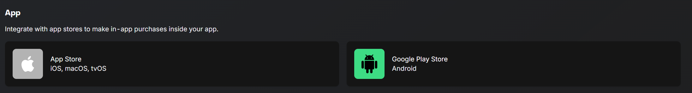

New projects also have a **Test Store** app. It allows you to test purchases without any store accounts (see [Testing](ue-plugins/revenuecat-unreal?id=testing)).

### Products, entitlements and offerings

1. Create the products in the stores (Google Play Console, App Store Connect, Web Billing) and add them to RevenueCat in **Product catalog** → **Products**.
2. Create an entitlement in **Product catalog** → **Entitlements** (e.g. `pro`), open it and attach the products that unlock it in the **Associated products** table.

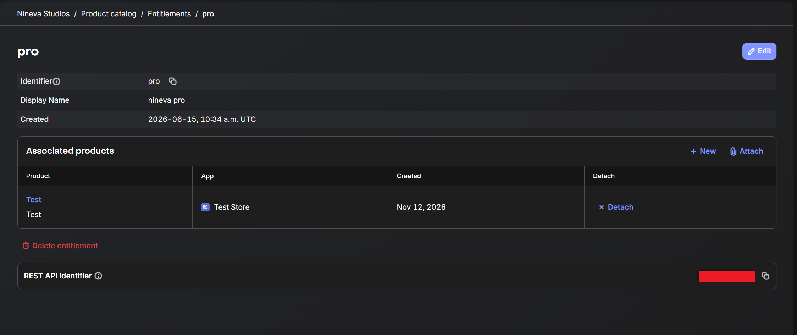

3. Create an offering in **Product catalog** → **Offerings**, add packages to it and select the product of every store for each package. One offering must be the current (default) one - the game receives it in `Offerings` → `Current`.

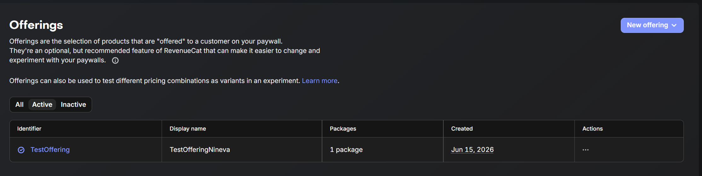

!> A purchase does not unlock anything if the product is not attached to an entitlement. If the purchase succeeds, but `Has Active Entitlement` returns false, check the entitlement settings first.

### API keys

Every app in the project has its own **public** API key. You can find them on the **API keys** page of the project (left sidebar) in the **SDK API keys** table. The **Secret API keys** table on the same page contains secret keys - they must never be used in the game.

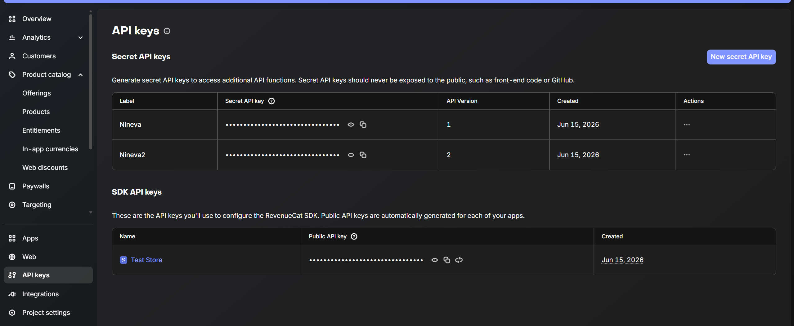

| Key prefix | App | Project Settings field |
| --- | --- | --- |
| `appl_` | App Store | `Apple Api Key` |
| `goog_` | Google Play Store | `Google Api Key` |
| `rcb_` | Web Billing | `Web Billing Api Key` |
| `test_` | Test Store | any field, for development only |

!> **Never put a secret API key (starts with `sk_`) into your project!** Secret keys give full access to your RevenueCat project and can be extracted from any game build. They are meant to be used only on your own server. If a secret key was exposed, revoke it in the dashboard and create a new one.

## Project Settings

The plugin settings are located in `Project Settings` → `Plugins` → `RevenueCat`.

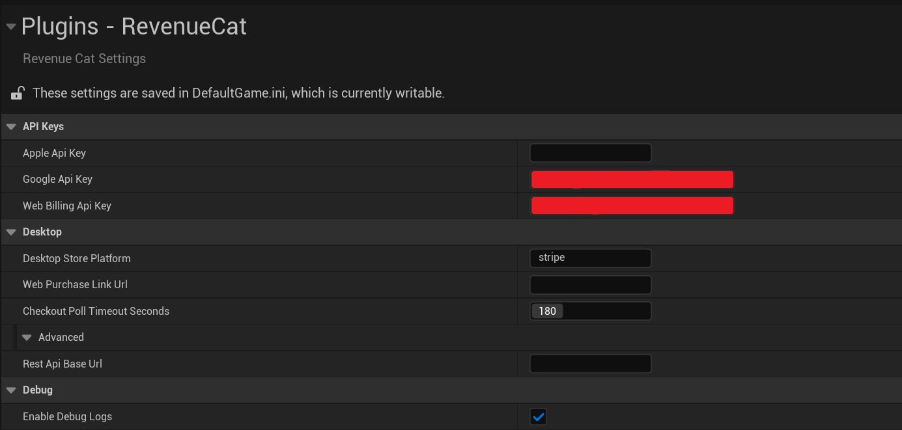

- `Apple Api Key` - public API key of your App Store app. Used in iOS builds.
- `Google Api Key` - public API key of your Google Play app. Used in Android builds.
- `Web Billing Api Key` - public API key of your Web Billing app. Used in Windows, Mac and Linux builds and in the Editor.
- `Desktop Store Platform` - the store whose products desktop builds receive in the offerings. Keep `stripe` for Web Billing.
- `Web Purchase Link Url` - the Web Purchase Link from the RevenueCat dashboard. Desktop purchases open this link in the browser. See [Desktop](ue-plugins/revenuecat-unreal?id=desktop).
- `Checkout Poll Timeout Seconds` - desktop only. How long the plugin waits for the player to complete the checkout in the browser.
- `Enable Debug Logs` - prints detailed RevenueCat logs. Disable it for release builds.
- `Rest Api Base Url` (advanced) - leave it empty. Set it only if you route desktop requests through your own proxy server that returns the same responses as the RevenueCat REST API v1.

The settings are saved to the `Config/DefaultGame.ini` file:

```ini
[/Script/RevenueCat.RevenueCatSettings]
AppleApiKey=appl_xxxxxxxxxxxxxxxxxxxxxxxxxxx
GoogleApiKey=goog_xxxxxxxxxxxxxxxxxxxxxxxxxxx
WebBillingApiKey=rcb_xxxxxxxxxxxxxxxxxxxxxxxxxxx
DesktopStorePlatform=stripe
WebPurchaseLinkUrl=https://pay.rev.cat/xxxxxxxxxxxx
CheckoutPollTimeoutSeconds=180
bEnableDebugLogs=False
```

## Android

?> Please, follow the recommendations from the [official documentation](https://www.revenuecat.com/docs/getting-started/installation/android) for most use cases and best practices.

[filename](common/afs_fix.md ':include')

The plugin adds everything required to the Android build automatically: the RevenueCat SDK Gradle dependency, the `com.android.vending.BILLING` permission and the ProGuard rules. You don't need to edit any Android files.

In `Project Settings` → `Platforms` → `Android`:

- `Android Package Name` must be the same as the package name of your app in Google Play Console and in RevenueCat.
- `Minimum SDK Version` must be `24` or higher.
- `Target SDK Version` must be the version currently required by Google Play.

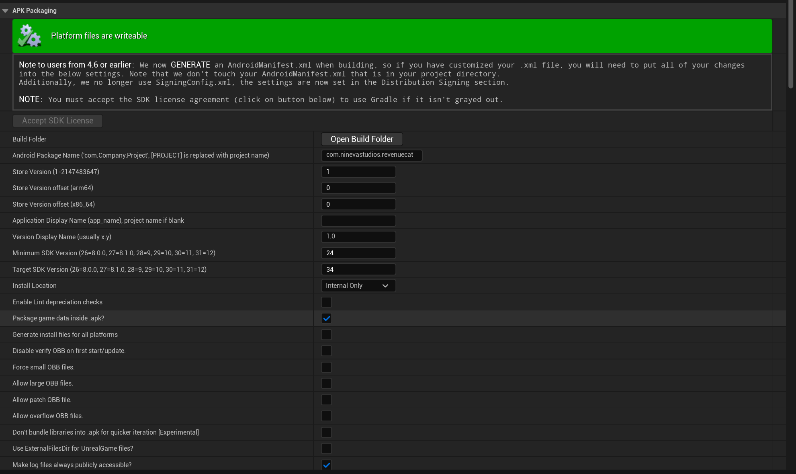

Google Play configuration:

1. Create the app and the in-app products or subscriptions in Google Play Console.
2. Upload a signed build of the game to the **Internal testing** track at least once. Google Play does not return any products for an app that was never uploaded.
3. Add your testers' Google accounts to **License testing** (`Settings` → `License testing`) and to the testing track. Testers have to accept the invitation link once.
4. Connect Google Play to RevenueCat with a service account - follow the [official guide](https://www.revenuecat.com/docs/service-credentials/creating-play-service-credentials). Without the service account credentials RevenueCat cannot validate the purchases.

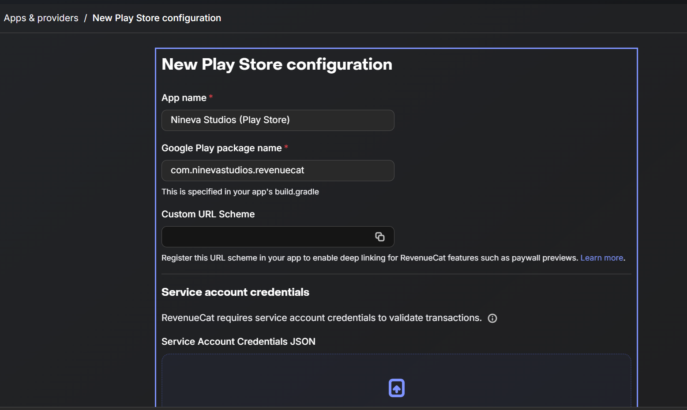

?> We recommend disabling the in-app purchasing of the `Online Subsystem Google Play` plugin if your project uses it, so that the Google Play Billing library is used only by RevenueCat. Add these lines to `Config/Android/AndroidEngine.ini`:

```ini
[OnlineSubsystemGooglePlay.Store]
bSupportsInAppPurchasing=false
```

!> The RevenueCat SDK works on real devices with Google Play installed. Unreal Engine builds for `arm64` only, so `x86_64` emulators are not supported.

Logs: filter `logcat` by the `RevenueCat` and `Purchases` tags. See [how to get a logcat log](ue-plugins/common-issues?id=how-do-i-get-a-logcat-log-from-my-android-device).

## iOS

<!-- TODO: re-check this section against the final iOS implementation before release.
     iOS branch is code-complete but not yet built/tested on a Mac - see Plugins/RevenueCat/IOS_BUILD_NOTES.md. -->

?> Please, follow the recommendations from the [official documentation](https://www.revenuecat.com/docs/getting-started/installation/ios) for most use cases and best practices.

The plugin contains the RevenueCat iOS SDK and embeds it into the app automatically. You don't need CocoaPods or Swift Package Manager, and you don't need to edit any Xcode or `Info.plist` files. As with any Unreal Engine iOS project, the build itself requires a Mac with Xcode.

In `Project Settings` → `Platforms` → `iOS` set the `Bundle Identifier` to the same value as the bundle ID of your app in App Store Connect and in RevenueCat. The provisioning profile must be for this explicit App ID: wildcard App IDs do not support In-App Purchase.

App Store configuration:

1. Sign the **Paid Applications Agreement** in App Store Connect (`Business` section). Without it no products are returned.
2. Create the in-app purchases or subscriptions for your app in App Store Connect.
3. Connect App Store Connect to RevenueCat with an **In-App Purchase Key** - follow the [official guide](https://www.revenuecat.com/docs/service-credentials/itunesconnect-app-specific-shared-secret/in-app-purchase-key-configuration).

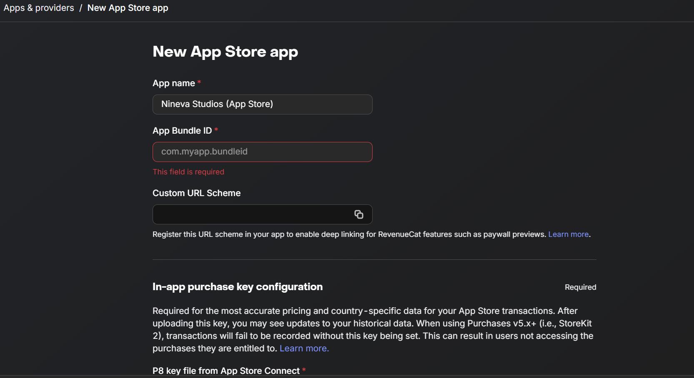

To test in-app purchases on iOS you need to either 1) Upload the app to internal testing via TestFlight or 2) Sign in with a [sandbox Apple Account](https://developer.apple.com/documentation/storekit/testing-in-app-purchases-with-sandbox) on the device.

?> When setting up the purchases in App Store Connect, make sure they are added to the app version on the app page when you submit the game for review.

Logs: run the game from Xcode, or open the device in the macOS `Console` app, and filter by `Purchases` and `LogRevenueCat`.

## Desktop

On Windows, Mac, Linux and in the Editor the plugin works with RevenueCat through the REST API. The payment itself happens on the RevenueCat Web Billing checkout page in the player's browser. This allows you to sell the same entitlements on PC (e.g. in your own launcher) that you sell on mobile.

Setup:

1. Add a **Web Billing** app to your RevenueCat project and connect your Stripe account. See the [official documentation](https://www.revenuecat.com/docs/web/web-billing/overview).
2. Create Web Billing products, attach them to the same entitlements and add them to the packages of your offering.
3. Create a **Web Purchase Link** for the offering and copy its URL to the `Web Purchase Link Url` field.
4. Copy the public API key of the Web Billing app to the `Web Billing Api Key` field.

<!-- TODO: add images/revenuecat/web-purchase-link.png (Web -> Web Purchase Link of the offering) once Web Billing is connected. -->

How a desktop purchase works:

1. `Purchase Store Package` opens the Web Purchase Link in the default browser. The current App User ID is added to the link, so the purchase is attributed to the right player.
2. The player completes the payment on the checkout page.
3. The plugin checks the Customer Info every 3 seconds. As soon as a new entitlement becomes active, the callback is invoked with the updated Customer Info.
4. If the player does not complete the checkout within `Checkout Poll Timeout Seconds`, the callback returns error `-3`. If the player pays later, call `Get Customer Info` to refresh the data.

!> On desktop, log the player in with your own account ID (see [Log In](ue-plugins/revenuecat-unreal?id=log-in-and-log-out)) before selling anything. The anonymous ID is stored only on the current computer for the current OS user, so an anonymous player loses access to their purchases on another computer.

Desktop limitations:

- The REST API does not return the store price and title of a product, so `Store Product` contains only the `Identifier`. Show the prices from your own data.
- The checkout page shows the packages of the offering the Web Purchase Link was created for. The player chooses the package on that page.
- `Restore Purchases` just reloads the Customer Info - Web Billing purchases are always linked to the App User ID.
- `Log In` does not transfer the purchases of the previous anonymous user to the identified user.

# RevenueCat Subsystem

All plugin functions are available in the `RevenueCat Subsystem`. It is a Game Instance Subsystem, so it is created automatically and lives as long as the game is running. All callbacks are invoked on the Game Thread.

In Blueprints right-click in any graph and search for `Revenue Cat Subsystem` (Unreal Engine shows the name with a space):

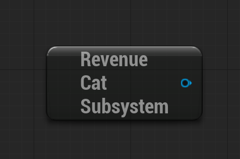

To use the plugin from C++, add the `RevenueCat` module to the dependencies in your `.Build.cs` file:

```csharp
PublicDependencyModuleNames.AddRange(new string[] { "Core", "CoreUObject", "Engine", "RevenueCat" });
```

and include the subsystem header:

```cpp
#include "RevenueCatSubsystem.h"

URevenueCatSubsystem* RevenueCat = GetGameInstance()->GetSubsystem<URevenueCatSubsystem>();
```

All asynchronous functions have an `On Done` pin. Drag a wire from it and select **Add Custom Event** - Unreal Engine creates an event with the correct parameters (e.g. `Customer Info` and `Error`). The event is called when the request is finished.

?> Always check the `Error` first: in Blueprints use `Break RCError` and compare `Code` with 0, in C++ call `Error.HasError()`. See [Error codes](ue-plugins/revenuecat-unreal?id=error-codes).

## Configure

Initializes RevenueCat. Call it once, as early as possible (e.g. in your Game Instance), before calling any other function. The API key for the current platform is taken from the [Project Settings](ue-plugins/revenuecat-unreal?id=project-settings).

<!-- tabs:start -->

#### **Blueprint**

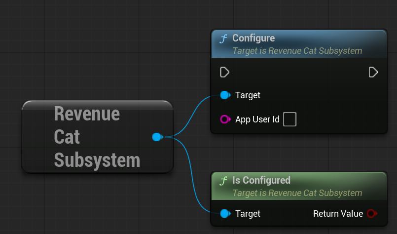

#### **C++**

```cpp
// Anonymous player. Use your own user ID instead if the player is already signed in.
GetGameInstance()->GetSubsystem<URevenueCatSubsystem>()->Configure(TEXT(""));
```

<!-- tabs:end -->

- `App User Id` - your own ID of the player. Leave it empty to use an anonymous ID. The ID used last time is restored automatically on the next launch.
- `Is Configured` - returns true after a successful `Configure` call.

!> If the API key for the current platform is empty, `Configure` fails and every other function returns error `-4` (not configured). Check the Output Log for the `LogRevenueCat` category.

## Log In and Log Out

RevenueCat stores the purchases of the player under the App User ID. If your game has its own account system, log the player in after they sign in, so that their purchases are available on all their devices and platforms.

<!-- tabs:start -->

#### **Blueprint**

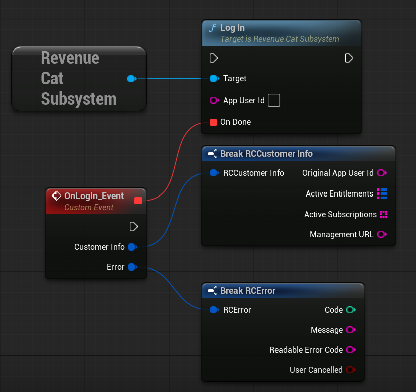

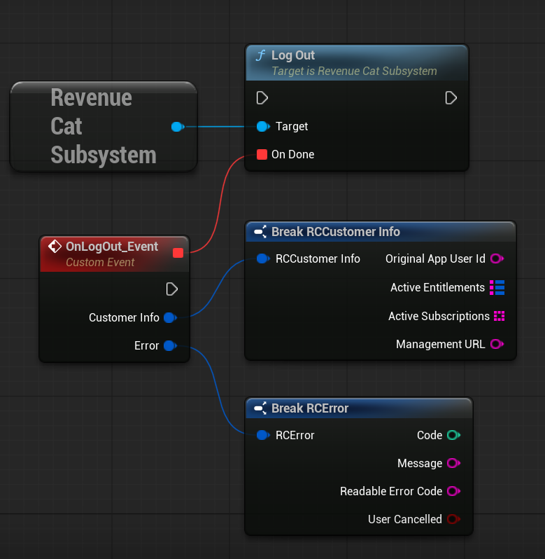

#### **C++**

```cpp
// MyGameInstance.h
UFUNCTION()
void OnRevenueCatLogIn(const FRCCustomerInfo& CustomerInfo, const FRCError& Error);

// MyGameInstance.cpp
void UMyGameInstance::OnAccountSignedIn(const FString& AccountId)
{
	FRCOnCustomer OnDone;
	OnDone.BindDynamic(this, &UMyGameInstance::OnRevenueCatLogIn);
	GetSubsystem<URevenueCatSubsystem>()->LogIn(AccountId, OnDone);
}

void UMyGameInstance::OnRevenueCatLogIn(const FRCCustomerInfo& CustomerInfo, const FRCError& Error)
{
	if (Error.HasError())
	{
		UE_LOG(LogTemp, Warning, TEXT("RevenueCat LogIn failed: [%d] %s"), Error.Code, *Error.Message);
		return;
	}
	// CustomerInfo now contains the entitlements of this account.
}
```

<!-- tabs:end -->

- `Log In` - switches to your own App User ID and returns the Customer Info of this user. If the player made purchases as an anonymous user before, RevenueCat transfers them to the identified user.
- `Log Out` - switches to a new anonymous App User ID. Call it when the player signs out of your account system. Returns error `22` if the current user is already anonymous.

!> Do not use e-mails, names or other personal or guessable data as the App User ID. Use the opaque user ID from your backend.

?> Read more about [identifying users](https://www.revenuecat.com/docs/customers/user-ids) and [transferring purchases between users](https://www.revenuecat.com/docs/projects/restore-behavior) in the official documentation.

## Offerings

Loads the offerings configured in the dashboard. Use `Offerings` → `Current` → `Packages` to build your paywall.

<!-- tabs:start -->

#### **Blueprint**

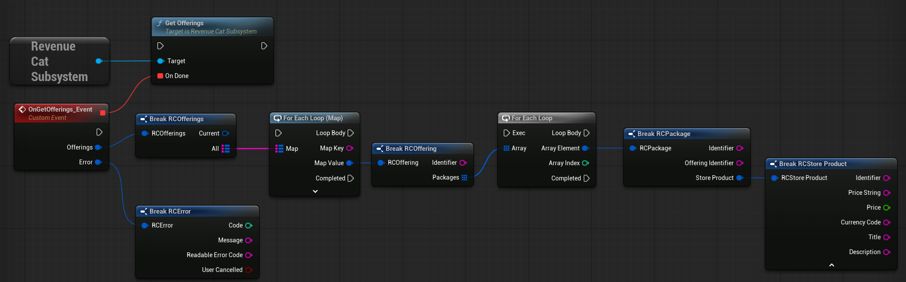

#### **C++**

```cpp
// MyStoreWidget.h
UFUNCTION()
void OnOfferingsLoaded(const FRCOfferings& Offerings, const FRCError& Error);

// MyStoreWidget.cpp
void UMyStoreWidget::LoadPaywall()
{
	FRCOnOfferings OnDone;
	OnDone.BindDynamic(this, &UMyStoreWidget::OnOfferingsLoaded);
	GetGameInstance()->GetSubsystem<URevenueCatSubsystem>()->GetOfferings(OnDone);
}

void UMyStoreWidget::OnOfferingsLoaded(const FRCOfferings& Offerings, const FRCError& Error)
{
	if (Error.HasError())
	{
		UE_LOG(LogTemp, Warning, TEXT("GetOfferings failed: [%d] %s"), Error.Code, *Error.Message);
		return;
	}

	for (const FRCPackage& Package : Offerings.Current.Packages)
	{
		// Package.StoreProduct.Title and Package.StoreProduct.PriceString are localized by the store.
		AddPackageButton(Package);
	}
}
```

<!-- tabs:end -->

- `Get Offerings` - loads all offerings. The result contains the `Current` offering and a map of `All` offerings by identifier.

The Blueprint example goes through `All` offerings and their packages and breaks every `Store Product`. For a paywall it is usually enough to use `Current` → `Packages`.

?> Always show the prices from `Store Product` → `Price String` on mobile. They are localized to the player's currency by the store. On desktop the price is not available, see [Desktop limitations](ue-plugins/revenuecat-unreal?id=desktop).

## Purchases

<!-- tabs:start -->

#### **Blueprint**

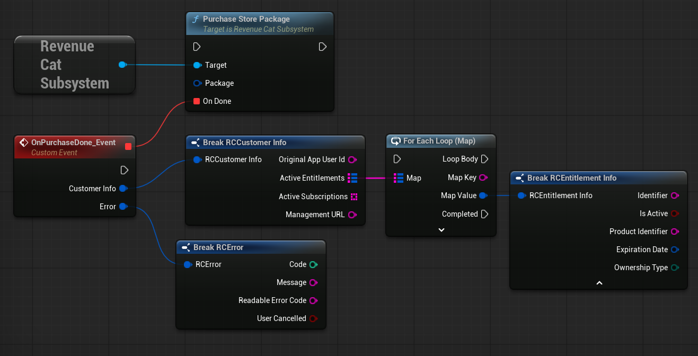

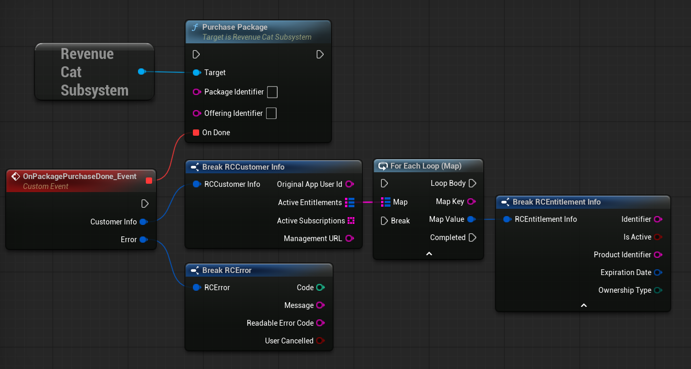

#### **C++**

```cpp
// MyStoreWidget.h
UFUNCTION()
void OnPurchaseFinished(const FRCCustomerInfo& CustomerInfo, const FRCError& Error);

// MyStoreWidget.cpp
void UMyStoreWidget::Buy(const FRCPackage& Package)
{
	FRCOnCustomer OnDone;
	OnDone.BindDynamic(this, &UMyStoreWidget::OnPurchaseFinished);
	GetGameInstance()->GetSubsystem<URevenueCatSubsystem>()->PurchaseStorePackage(Package, OnDone);
}

void UMyStoreWidget::OnPurchaseFinished(const FRCCustomerInfo& CustomerInfo, const FRCError& Error)
{
	if (Error.bUserCancelled)
	{
		return; // The player closed the store dialog - not an error.
	}
	if (Error.HasError())
	{
		ShowPurchaseFailed(Error.Message);
		return;
	}
	if (CustomerInfo.ActiveEntitlements.Contains(TEXT("pro")))
	{
		UnlockPro();
	}
}
```

<!-- tabs:end -->

- `Purchase Store Package` - purchases a package received from `Get Offerings`. This is the recommended way to make purchases.
- `Purchase Package` - purchases a package by its identifiers, e.g. package `$rc_monthly` of offering `default`. Both identifiers are required.

The callback returns the updated Customer Info. Check the entitlement you sell in `Active Entitlements` to unlock the content.

?> If `User Cancelled` is true, the player closed the store dialog. Don't show an error message in this case.

?> RevenueCat finishes (acknowledges) the transactions automatically, you don't need to do it yourself.

?> Consumable products (e.g. coins) don't unlock entitlements. Grant the item when the purchase returns without an error, or - if the currency is stored on your server - when your server receives the RevenueCat [webhook](https://www.revenuecat.com/docs/integrations/webhooks).

## Customer Info

Customer Info contains the current access of the player. Check it when the game starts and every time you need to know whether the content is unlocked.

<!-- tabs:start -->

#### **Blueprint**

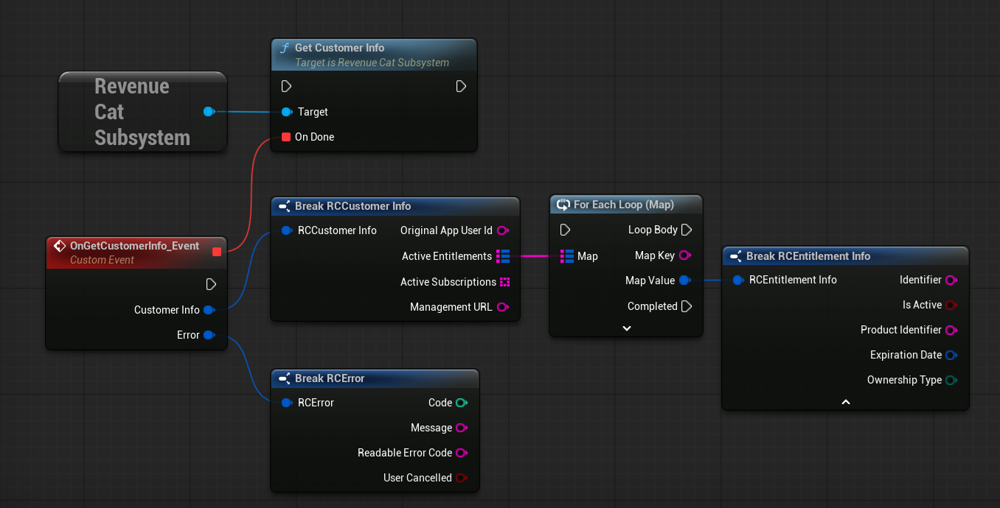

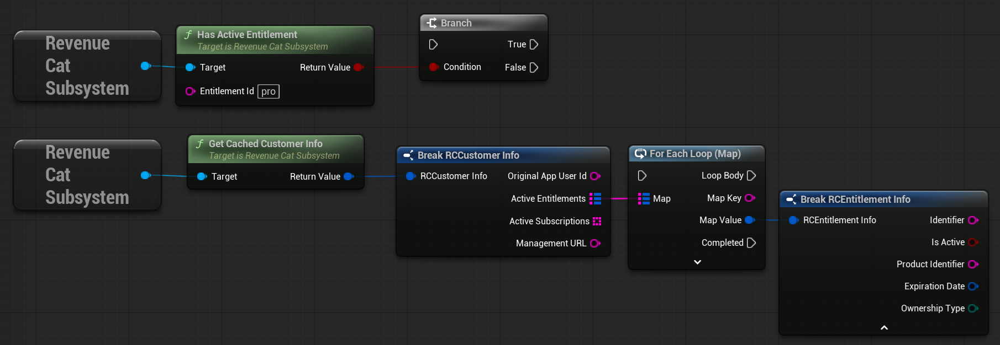

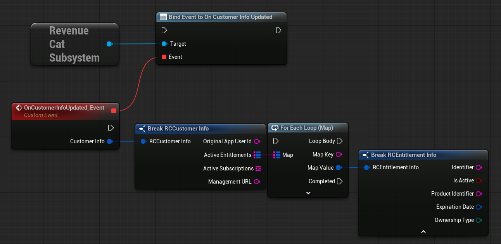

#### **C++**

```cpp
// MyGameInstance.h
UFUNCTION()
void OnCustomerInfoUpdated(const FRCCustomerInfo& CustomerInfo);

// MyGameInstance.cpp
void UMyGameInstance::InitPurchases()
{
	URevenueCatSubsystem* RevenueCat = GetSubsystem<URevenueCatSubsystem>();
	RevenueCat->OnCustomerInfoUpdated.AddDynamic(this, &UMyGameInstance::OnCustomerInfoUpdated);
	RevenueCat->Configure(TEXT(""));
	RevenueCat->GetCustomerInfo(FRCOnCustomer()); // the result also arrives in OnCustomerInfoUpdated
}

void UMyGameInstance::OnCustomerInfoUpdated(const FRCCustomerInfo& CustomerInfo)
{
	const bool bIsPro = CustomerInfo.ActiveEntitlements.Contains(TEXT("pro"));
	SetProUnlocked(bIsPro);
}

// Anywhere later, without a request:
const bool bIsPro = GetSubsystem<URevenueCatSubsystem>()->HasActiveEntitlement(TEXT("pro"));
```

<!-- tabs:end -->

- `Get Customer Info` - requests the latest Customer Info of the current player.
- `Has Active Entitlement` - checks the last received Customer Info for an active entitlement. It does not make a request, so call `Get Customer Info` at least once after `Configure`.
- `Get Cached Customer Info` - returns the last received Customer Info without a request.
- `On Customer Info Updated` - event that fires every time new Customer Info is received: after a purchase, restore, log in, log out or refresh. Bind to it once with `Bind Event to On Customer Info Updated` to keep your UI up to date.

!> Client-side checks can be bypassed by a modified game build. They are fine for unlocking single-player content, but for valuable content (multiplayer advantages, virtual currency, items stored on a server) verify the entitlements on your server. See [Security](ue-plugins/revenuecat-unreal?id=security).

## Restore Purchases

Restores the purchases made with the current store account (e.g. after reinstalling the game or on a new device) and returns the updated Customer Info.

<!-- tabs:start -->

#### **Blueprint**

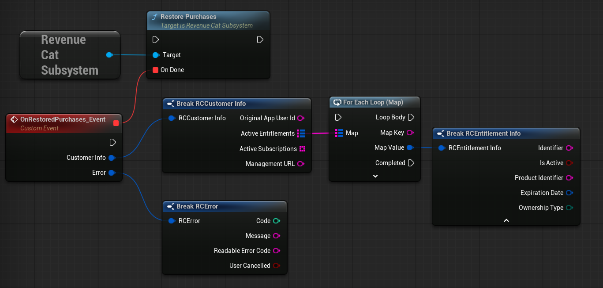

#### **C++**

```cpp
FRCOnCustomer OnDone;
OnDone.BindDynamic(this, &UMyStoreWidget::OnPurchaseFinished);
GetGameInstance()->GetSubsystem<URevenueCatSubsystem>()->RestorePurchases(OnDone);
```

<!-- tabs:end -->

!> Apple requires a **Restore Purchases** button in games that sell non-consumable products or subscriptions. Call `Restore Purchases` only when the player presses this button, not automatically on every launch.

# Data types

In Blueprints the structures are shown with the `RC` prefix, e.g. `Break RCCustomer Info`. In C++ they have the `FRC` prefix, e.g. `FRCCustomerInfo`.

## Customer Info

Blueprint: `RCCustomer Info`, C++: `FRCCustomerInfo`.

- `Original App User Id` - the first App User ID of this customer.
- `Active Entitlements` - map of the active entitlements: entitlement identifier → `Entitlement Info`.
- `Active Subscriptions` - product identifiers of the active subscriptions.
- `Management URL` - link to the page where the player can manage or cancel their subscription. Empty if not available.

## Entitlement Info

Blueprint: `RCEntitlement Info`, C++: `FRCEntitlementInfo`.

- `Identifier` - entitlement identifier from the dashboard, e.g. `pro`.
- `Is Active` - whether the entitlement currently gives access. Also true during a billing grace period.
- `Product Identifier` - the product that unlocked the entitlement.
- `Expiration Date` - when the access ends (UTC). Empty (`0001.01.01`) for lifetime purchases.
- `Ownership Type` - `Purchased`, `Family Shared` (iOS Family Sharing) or `Unknown`.

## Offerings, Offering and Package

Blueprint: `RCOfferings`, `RCOffering`, `RCPackage`, C++: `FRCOfferings`, `FRCOffering`, `FRCPackage`.

- `Offerings` → `Current` - the offering marked as current in the dashboard. Use it for your main paywall.
- `Offerings` → `All` - map of all offerings by identifier.
- `Offering` → `Identifier` and `Packages` - the identifier and the packages of the offering.
- `Package` → `Identifier` - e.g. `$rc_monthly`, `$rc_annual`, `$rc_lifetime` or a custom identifier.
- `Package` → `Offering Identifier` - the offering the package belongs to.
- `Package` → `Store Product` - the product of the current store.

## Store Product

Blueprint: `RCStore Product`, C++: `FRCStoreProduct`.

- `Identifier` - product identifier in the store.
- `Price String` - localized price with the currency, e.g. `$9.99`. Use it in your UI.
- `Price` - numeric price.
- `Currency Code` - ISO 4217 currency code, e.g. `USD`.
- `Title` and `Description` - product title and description from the store.

?> On desktop only `Identifier` is filled, see [Desktop limitations](ue-plugins/revenuecat-unreal?id=desktop).

## Error

Blueprint: `RCError`, C++: `FRCError`.

- `Code` - `0` if there is no error. See [Error codes](ue-plugins/revenuecat-unreal?id=error-codes).
- `Message` - description of the error. Log it, but don't show raw messages to the players.
- `Readable Error Code` - name of the code, e.g. `PurchaseCancelledError` (Android and iOS).
- `User Cancelled` - true if the player cancelled the purchase.

# Typical flows

## Game start

Bind `On Customer Info Updated`, call `Configure` and load the Customer Info to unlock the purchased content. If your game has accounts, call `Log In` after the player signs in.

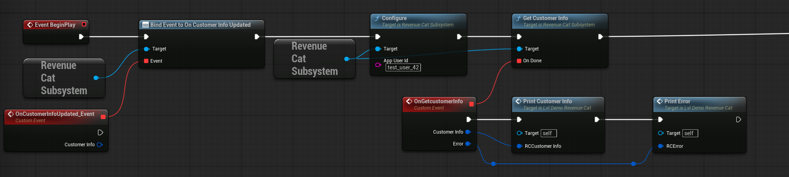

The example is taken from the demo level: it runs on `BeginPlay`, and `Print Customer Info` / `Print Error` are helper functions of the level. The demo uses a fixed test App User ID - in your game leave it empty or use the ID from your account system. It is recommended to configure RevenueCat in your Game Instance, so it is done only once per game session.

## Paywall

Load the offerings when the paywall opens and check the error first:

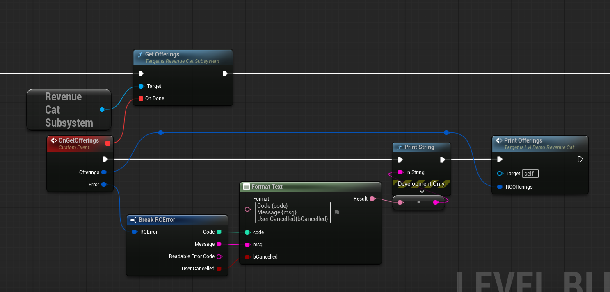

Then show the packages of the `Current` offering (the demo level passes them to its `Print Offerings` helper function), call `Purchase Store Package` when the player selects a package and check the entitlement in the result (see [Purchases](ue-plugins/revenuecat-unreal?id=purchases)). Add a **Restore Purchases** button to the paywall.

## Same purchases on mobile and PC

Use the same App User ID on all platforms: call `Log In` with the ID from your account system on every device. A subscription bought on Android then unlocks the `pro` entitlement on iOS and PC as well (and vice versa), because all platforms share the same entitlements in one RevenueCat project.

# Demo

The plugin contains a demo level `Content/Demo/Maps/Lvl_Demo_RevenueCat`. To see the plugin content in the Content Browser, enable `Settings` → `Show Plugin Content`.

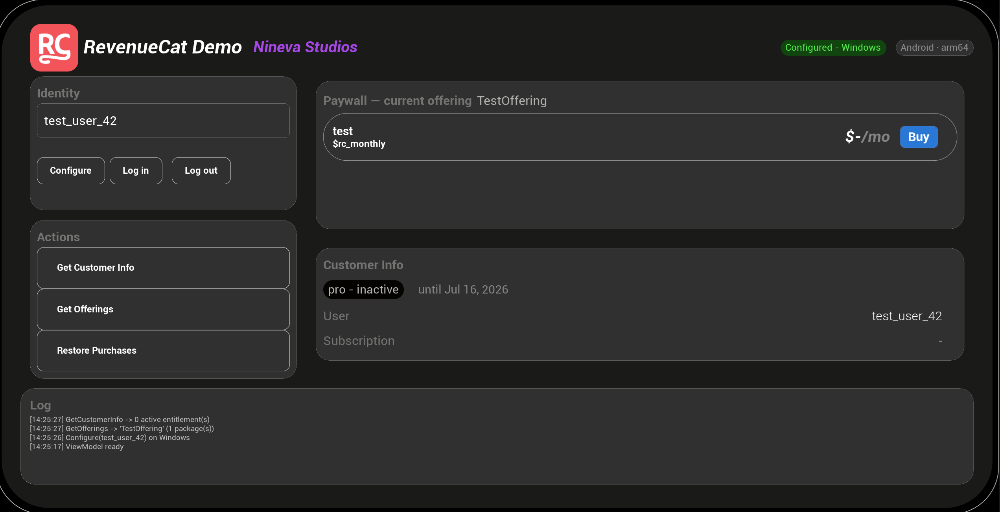

The demo shows every function of the plugin:

- **Identity** - `Configure`, `Log in` and `Log out` with the App User ID from the text field.
- **Actions** - `Get Customer Info`, `Get Offerings` and `Restore Purchases`.
- **Paywall** - the packages of the current offering with a `Buy` button for each of them. On desktop the price is not available, so the demo shows `-` instead.
- **Customer Info** - the state of the `pro` entitlement, the App User ID and the active subscription.
- **Log** - all calls and errors, the newest on top.

The demo UI (`WBP_RevenueCatDemo` and `WBP_PackageRow`) is made with the Unreal Engine [MVVM](https://dev.epicgames.com/documentation/en-us/unreal-engine/umg-viewmodel-for-unreal-engine) plugin. All logic is located in the C++ ViewModels of the `RevenueCatUI` module, the widgets only contain bindings:

- `RCDemoViewModel` - the screen: status, App User ID, entitlement state, packages, log and the commands (`Configure Cmd`, `Log In Cmd`, `Purchase`, `Restore Cmd` etc.).
- `RCPackageItemViewModel` - one row of the packages list: display name, price, product identifier and `Purchase This`.

You can copy the demo widgets to your project and change their design without touching the logic.

?> The `RevenueCatUI` module is used only by the demo. Your game does not depend on it.

# Testing

?> Please, follow the [official testing guide](https://www.revenuecat.com/docs/test-and-launch/sandbox) for most use cases and best practices.

- **Test Store** - put the `test_` API key of the Test Store app into the field of the platform you test. RevenueCat then returns the Test Store products, and on mobile the purchase opens a test dialog where you can simulate a successful or a failed purchase. No store accounts are needed.
- **Grant an entitlement** - open the customer in the dashboard (`Customers`) and grant a promotional entitlement. This is the fastest way to test the unlocked state on any platform, including desktop.
- **Google Play** - use a license tester account and a build installed from the testing track.
- **App Store** - use TestFlight or a sandbox Apple Account.
- **Web Billing** - use the sandbox API key of the Web Billing app and Stripe test cards.

Enable `View sandbox data` on the RevenueCat dashboard to see the test purchases and customers.

# Security

- Put only **public** API keys into the project. Never use secret (`sk_`) keys in the game.
- `Has Active Entitlement` and Customer Info checks on the client are meant for the UI and single-player content. A modified game build can bypass them.
- For valuable content verify the access on your own server: request `GET https://api.revenuecat.com/v1/subscribers/{app_user_id}` with your secret key from the server, or process the RevenueCat [webhooks](https://www.revenuecat.com/docs/integrations/webhooks).
- Use opaque IDs from your backend as App User IDs. Anyone who knows an App User ID can read the Customer Info of that user with a public key.

# Error codes

Positive codes are the official RevenueCat SDK codes, they are the same on Android and iOS. Negative codes are produced by the plugin. The full list of the SDK codes and solutions is available in the [official documentation](https://www.revenuecat.com/docs/test-and-launch/errors).

| Code | Name | Platform | Description |
| --- | --- | --- | --- |
| `-1` | Internal | All | A native call failed or returned an unexpected response. See `Message` and the logs. |
| `-2` | Web Purchase Link not set | Desktop | `Web Purchase Link Url` is empty in the Project Settings. |
| `-3` | Checkout timeout | Desktop | The player did not complete the checkout within `Checkout Poll Timeout Seconds`. If they pay later, call `Get Customer Info`. |
| `-4` | Not configured | All | `Configure` was not called or the API key of the current platform is empty. |
| `1` | PurchaseCancelledError | Mobile | The player cancelled the purchase. `User Cancelled` is true - don't show an error. |
| `2` | StoreProblemError | Mobile | Problem with the store. Try again later. |
| `3` | PurchaseNotAllowedError | Mobile | The device or the user is not allowed to make purchases (e.g. parental controls). |
| `5` | ProductNotAvailableForPurchaseError | Mobile | The product is not available in the store. Check the product status and the store configuration. |
| `6` | ProductAlreadyPurchasedError | Mobile | The product is already owned. Call `Restore Purchases`. |
| `7` | ReceiptAlreadyInUseError | Mobile | The purchase belongs to another App User ID. See [restore behavior](https://www.revenuecat.com/docs/projects/restore-behavior). |
| `10` | NetworkError | All | No connection to RevenueCat or the store. |
| `11` | InvalidCredentialsError | Mobile | Wrong API key or invalid store credentials in the RevenueCat dashboard. |
| `14` | InvalidAppUserIdError | All | The App User ID is empty or invalid. |
| `15` | OperationAlreadyInProgressError | Mobile | Another purchase is in progress. Wait for its result. |
| `20` | PaymentPendingError | Mobile | The payment is pending (e.g. cash payment). The entitlement is unlocked when the payment completes. |
| `22` | LogOutWithAnonymousUserError | All | `Log Out` was called while the user is anonymous. |
| `23` | ConfigurationError | Mobile | Configuration problem in the dashboard or in the store. See `Message`. |
| `42` | TestStoreSimulatedPurchaseError | Mobile | You chose a failed purchase in the Test Store dialog. |
| `7xxx` | RevenueCat backend error | Desktop | The RevenueCat REST API returned an error, e.g. an invalid API key. See `Message`. |

## Troubleshooting

### Every function returns "not configured" (`-4`)

`Configure` was not called before other functions, or the API key of the current platform is empty. Note that every platform uses its own field: Android - `Google Api Key`, iOS - `Apple Api Key`, desktop and Editor - `Web Billing Api Key`.

### Offerings are empty

- No offering is marked as **Current** in the dashboard, or the packages have no product for the current store.
- Android: the app was never uploaded to Google Play, the products are not active, or the package name is different.
- iOS: the Paid Applications Agreement is not signed, or the products are not ready in App Store Connect.
- Desktop: `Desktop Store Platform` does not match the store of the products (use `stripe` for Web Billing).

### Purchase succeeded, but the entitlement is not active

The purchased product is not attached to the entitlement in the dashboard.

### Where are the logs?

Enable `Enable Debug Logs` in the plugin settings. In the Editor and on desktop filter the Output Log by `LogRevenueCat`. On Android use `logcat` with the `RevenueCat` and `Purchases` tags, on iOS - the Xcode console. See the [common issues page](ue-plugins/common-issues) for details.

# Changelog

### 1.0.0

- Initial release

---
